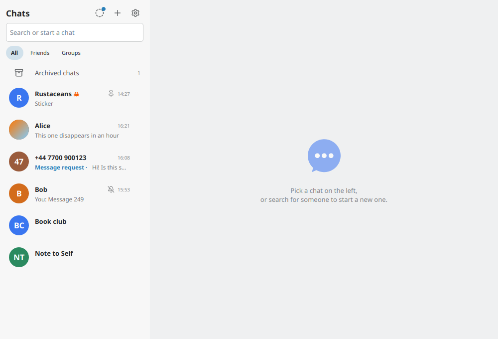
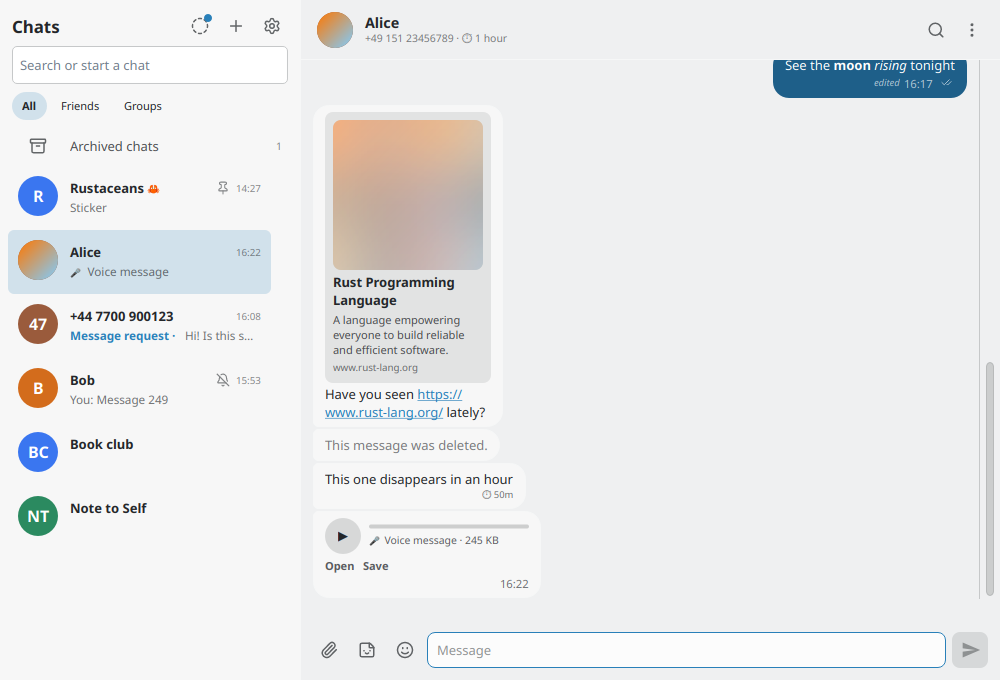
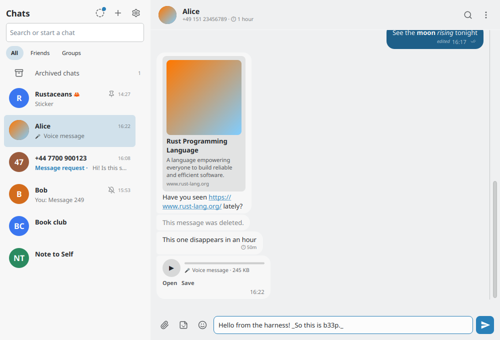
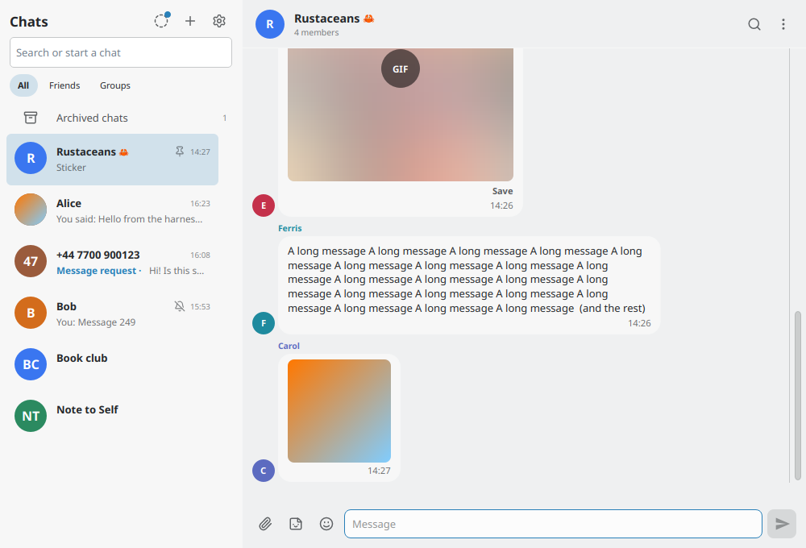
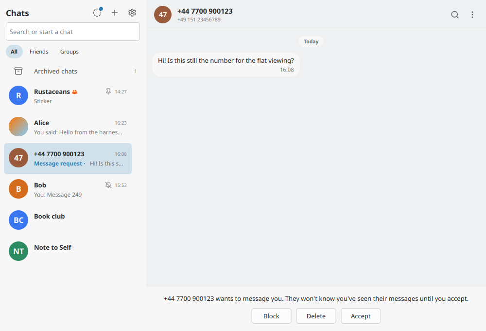
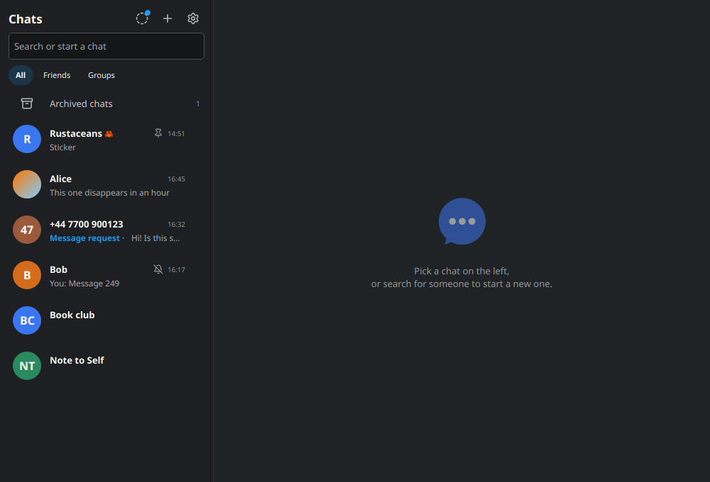
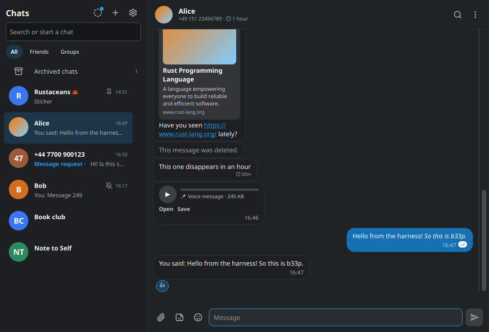
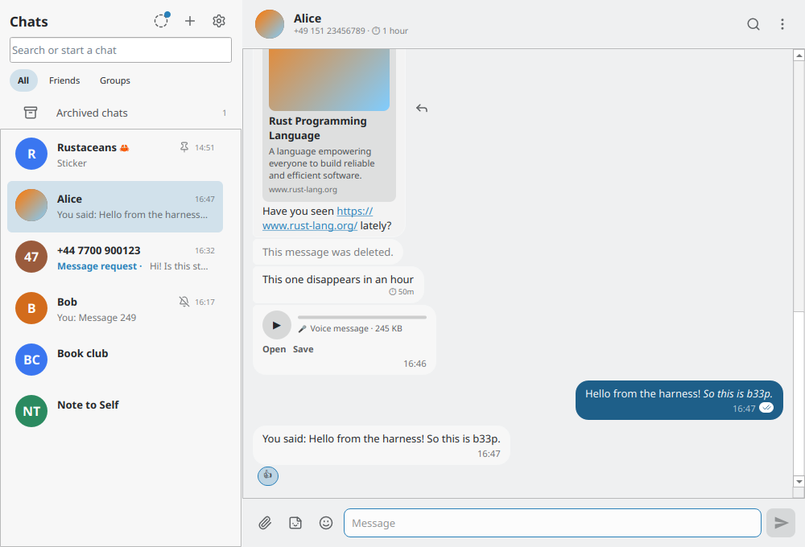
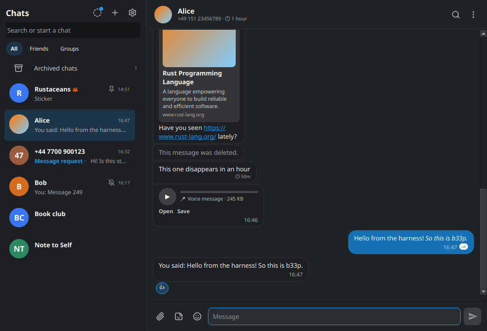
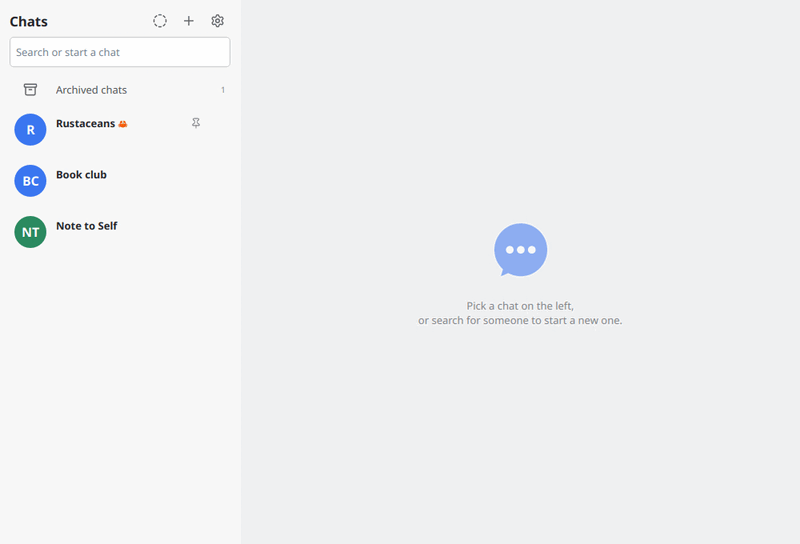

# b33p

A cross-platform Signal client for the desktop, built with Rust and [Slint](https://slint.dev).
It links as a companion device, keeps an encrypted local store, and lives in the tray between
messages.


| | | |
|---|---|---|
|  |  |  |
|  |  |  |

In the desktop's dark scheme, and in the other widget style the settings offer:

| | | |
|---|---|---|
|  |  |  |

In motion: an agent selects a chat, types word by word, sends, and watches the message get
read, answered and reacted to:



## What works

- Linking (with message history transfer), relinking, encrypted store (keyring or password)
- Read state and receipts, delivery ticks, typing indicators, edits and deletions, disappearing
  messages, markdown formatting, mentions
- Message requests, blocking, pinned / muted / archived chats, folders, Note to Self
- Groups: create, rename, describe, timer, members and admins, leave, invitations
- Attachments: pictures, voice messages and audio playback, files, stickers, link previews,
  paste and drag-and-drop
- Search in a chat and in the chat list, media overview, forwarding, stories
- Desktop notifications with click-to-open and inline reply, tray icon, single instance,
  keyboard shortcuts, screen-reader labels, reduced-motion support

Payments and calls are out of scope. Nothing here has been verified against a real account
yet; see [PLAN.md](PLAN.md) for where that stands and [TESTPLAN.md](TESTPLAN.md) for the
checklist.

## Building and running

You need Rust and, on Linux, Qt 6 (the native style draws real Qt widgets); elsewhere Slint's
own windowing backend is used. [packaging/](packaging) has per-platform notes.

```sh
cargo run --release            # the real client
cargo run                      # the same, unoptimized
B33P_MOCK=1 cargo run          # an offline fake, for trying the UI: nothing is sent
```

`B33P_MOCK` only works in debug builds — a stray variable in the environment must not turn a
release binary into a convincing fake that swallows messages. The mock's window says so in its
title, and it answers whatever you send.

## Layout

| Crate | What it is |
|---|---|
| `b33p-core` | The chat state and the backends: the real Signal backend (over [presage](https://github.com/whisperfish/presage)) and the mock. A headless state machine: events in, updates out; actions return commands. |
| `b33p-slint` | The window: Slint UI wired to the chat state, tray, notifications playback, and the agent harness. |
| `b33p-notify` | Desktop notifications with click-to-open and inline reply. |

## Driving the UI without mouse or keyboard: the agent harness

For tests and demonstrations, the UI can be driven by a script. With the `harness` feature
built in and `B33P_AGENT_SOCKET` pointing at a path, the app listens on a Unix socket where an
agent reads what the window shows and acts as if it were the input — through the same code
paths a person's clicks and keystrokes take. The protocol is one JSON document per line:

```jsonc
→ {"id":1,"method":"snapshot"}
← {"id":1,"result":{"screen":{"name":"chats"},"conversations":[…],"messages":[…],"draft":"", …}}
→ {"id":2,"method":"act","action":{"type":"select","conversation":"c:alice"}}
← {"id":2,"result":{"command_sent":true}}
→ {"id":3,"method":"subscribe"}
← {"id":3,"result":{"seq":0}}
← {"event":"update","seq":1,"snapshot":{…}}          // pushed after every redraw
```

Actions cover navigation, messaging, groups, settings and more — see the `Action` enum in
[`b33p-slint/src/agent.rs`](b33p-slint/src/agent.rs), which also documents the protocol;
[`b33p-slint/tests/harness.rs`](b33p-slint/tests/harness.rs) is a working client. The socket's
file is `0600`, so only programs of your own user can connect, and it carries message
plaintext: point `B33P_AGENT_SOCKET` into a private directory.

The harness never exists in a release build:

```sh
B33P_MOCK=1 B33P_AGENT_SOCKET="$XDG_RUNTIME_DIR/b33p-agent.sock" \
    cargo run --features harness
```

The screenshots above were taken that way: a script opened the mock, clicked around, and
captured the window at each step.

## Tests

```sh
cargo test                                # unit tests and the window's own behaviour
cargo test -p b33p-slint --features harness   # end-to-end: drives the mock over the harness
```

## License

AGPL-3.0-only. b33p links [libsignal](https://github.com/signalapp/libsignal) and presage,
which are AGPL, so the whole work is.
