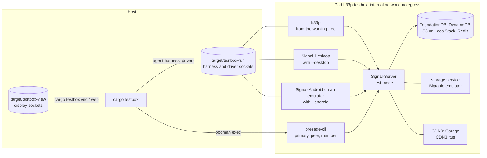
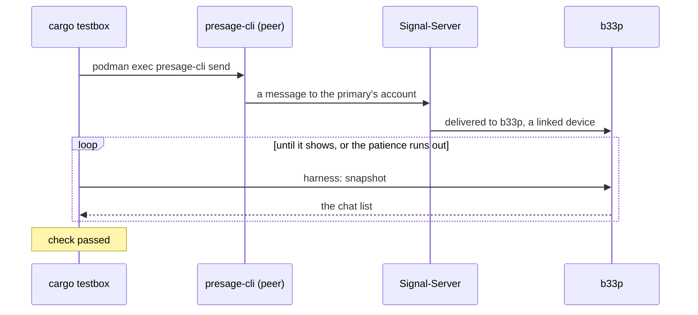
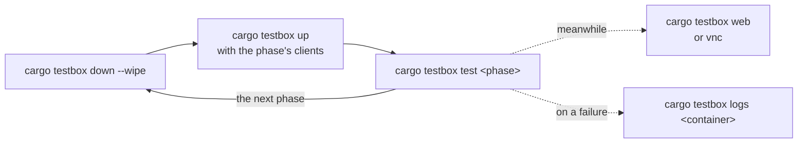

# testbox

Checks b33p against Signal's own server and clients, in one Podman pod on your machine:
Signal-Server in its test mode with the stores and CDNs it uses, the storage service, Signal-Desktop
and Signal-Android on an emulator. presage-cli plays the primary devices b33p links to. The pod's
network is internal: nothing in it reaches Signal or anything else outside. Every upstream is
pinned, and images take network only while they build.

A pass shows that b33p agrees with Signal-Server's test mode and Signal's clients at their pins,
not with Signal's servers. Out of reach are what runs in Signal's enclaves (contact discovery,
SVR), a production phone's history, and Signal's servers themselves.

`cargo testbox --help` is the reference for the commands; `cargo testbox` is a Cargo alias
(`.cargo/config.toml`) of the `xtask` package.

## What is in the box



The xtask drives each client the way a person would: b33p through its
[agent harness](../b33p-harness) (what the window shows, and actions through the same code paths
as clicks and keys), Desktop and Android through drivers of their own (`testbox/desktop/driver.ts`,
`testbox/tools/src/bin/android.rs`), presage-cli by running it in its container. A check then
waits for what should show on the other side:



## What the host needs

- Linux with Podman, rootless: your user needs a subuid and subgid range (`/etc/subuid`,
  `/etc/subgid`). Netavark makes the pod's internal bridge, so the kernel's `bridge` and `veth`
  modules must load. Right after a kernel update, reboot first: until then the running kernel's
  modules may be gone, and `up` fails with `netavark: create bridge: Netlink error: Operation not
  supported`.
- `/dev/kvm`, readable and writable, for Signal-Android's emulator.
- Network while the images build, and room for them: around 10 GB of images, and build caches on
  top. The first `up` builds Signal-Server, the storage service, Signal-Desktop, libsignal and
  Signal-Android from source and takes a long while; later ones reuse the cache, and only b33p
  is rebuilt when it changes.
- Rust, as for b33p itself. `cargo testbox vnc` opens a window; `cargo testbox web` serves the
  displays as a page on loopback instead.

## Running a phase

Each phase needs a fresh box: b33p must start unlinked, and the accounts must start new. So a
phase is always the same three steps:



| Phase | `up` with | What it checks |
|---|---|---|
| `core` | | b33p linked to a presage-cli primary, with a presage-cli peer: text both ways, a message request, delivery receipts, reconnecting after the server drops, a send it leaves unanswered and its retry |
| `desktop` | `--desktop` | Signal-Desktop, linked to the peer, on the other end of b33p: receipts, edits, formatting, reactions, replies, deletes and emoji each way |
| `attachments` | `--desktop` | pictures, files and audio through CDN3 between b33p and Desktop; a profile picture and a sticker pack through CDN0 |
| `android` | `--desktop --android` | Signal-Android registers as the primary and b33p links to it; Desktop links to the peer; text and receipts between the two accounts, each one's linked device in step |
| `storage` | `--desktop --android` | chat settings through the storage service, between b33p, Android (the primary) and Desktop |
| `groups` | `--desktop --android` | a group b33p makes with the peer and a presage-cli member; what b33p changes shows on Desktop and Android, and what they change on b33p |

The first time, start with the smallest box:

```sh
cargo testbox up
cargo testbox test core
```

Each check prints `check <what>: passed` or `failed: <why>`; `test` fails if any did. The
phases' checks are in `xtask/src/checks/`, one file per phase.

`cargo testbox run` does the three steps for each phase in turn, the clients each needs
included, and sums up at the end: `cargo testbox run --rounds 2` runs every phase twice,
`cargo testbox run desktop groups` only those.

b33p is a debug build in the box, as in the checks' own builds. `--optimized` (on `up` and `run`)
builds it optimized as it ships instead, which takes longer: for what only shows in an
optimized build, or is too slow to tell apart in a debug one. It keeps debug assertions on
(Cargo.toml's `testbox` profile), since b33p refuses its test servers in a release build. `--b33p-memory <MiB>` limits b33p's
container to that much memory, as a small machine would: past it the kernel kills b33p, and
"no client crashed" fails.

`stress-volume`, `stress-interrupt`, `stress-content`, `stress-concurrency` and `stress-soak`
aren't among `run`'s phases unless named: bursts of messages; b33p killed while it receives,
sends and saves; awkward texts, broken and huge pictures, odd file names; several clients
sending at once; half an hour of mixed traffic (`TESTBOX_SOAK_MINUTES`, from a seed it prints,
which `TESTBOX_SEED` repeats) while b33p's memory and open files are watched
([pending/stress.md](../pending/stress.md)).

## Watching and looking into a failure

- `cargo testbox web` prints the address of a page with each client's display; `cargo testbox vnc`
  shows them in a window. Without `--interactive` they only show: your keys and clicks would race
  the drivers'.
- Every phase leaves a record in `target/testbox-record/<phase>/` (`run`'s in
  `target/testbox-record/run/<when it started>/<round>-<phase>/`): each container's log,
  Desktop's own logs and Android's logcat as they were at the phase's end, so they outlast the
  next `down --wipe`.
- `test --screenshots` (and `run --screenshots`) also takes each client's display after each
  check into the record, numbered in the order of the checks and named after them
  (`07-text-from-b33p-reaches-desktop-b33p.png`); `testbox/shot` takes them over the displays'
  sockets.
- `cargo testbox logs b33p server` prints those containers' logs; the names are those in
  `pod.yaml` (`b33p`, `server`, `storage`, `presage`, `desktop`, `android`, …). The box stays up
  after `test`, so a failed phase can be looked at as it was.
- `cargo testbox qr` puts the link QR b33p shows on the emulator camera's poster, for linking by
  hand in Android's scanner.
- `cargo testbox down` stops the pod and keeps the accounts and stores; `down --wipe` removes them
  too.

## Layout

| Path | What it is |
|---|---|
| `pod.yaml` | The pod for `podman kube play`; `desktop/pod.yaml` and `android/pod.yaml` are the clients' containers, put in when asked for |
| `<service>/Containerfile` | Each image, built at pinned revisions |
| `patches/` | What libsignal and Signal-Android need to run against a local server |
| `tools/` | The containers' entrypoints (`provision` makes the box's keys and servers file), the Android driver, and the drivers' protocol |
| `desktop/driver.ts` | The Signal-Desktop driver, on Playwright |
| `vnc/`, `viewer/`, `web/`, `shot/` | The displays: the VNC client, the window, the page, the screenshots |
| `presage/`, `stickers/` | presage-cli at b33p's pin, and the tool that seeds a sticker pack |
| `../xtask` | `cargo testbox` itself: bringing the pod up and down, and the phases' checks |
