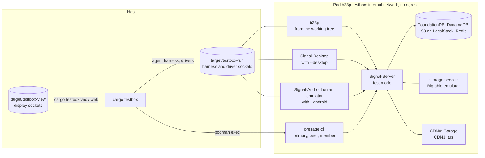
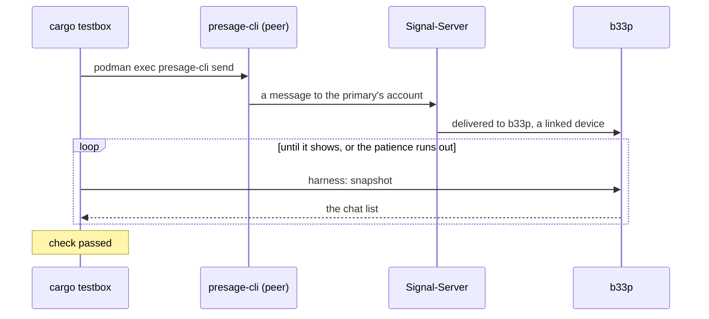
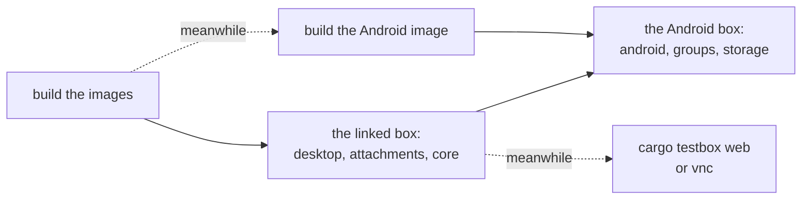

# testbox

Checks b33p against Signal's own server and clients, in one Podman pod on your machine:
Signal-Server in its test mode with the stores and CDNs it uses, the storage service, Signal-Desktop
and Signal-Android on an emulator. presage-cli plays the primary devices b33p links to. The pod's
network is internal: nothing in it reaches Signal or anything else outside. Every upstream is
pinned, and images take network only while they build.

A pass shows that b33p agrees with Signal-Server's test mode and Signal's clients at their pins,
not with Signal's servers. Out of reach are what runs in Signal's enclaves (contact discovery,
SVR), a production phone's history, and Signal's servers themselves.

`cargo testbox --help` is the reference for the commands; `cargo testbox` is a Cargo alias
(`.cargo/config.toml`) of the `xtask` package.

## What is in the box



The xtask drives each client the way a person would: b33p through its
[agent harness](../b33p-harness) (what the window shows, and actions through the same code paths
as clicks and keys), Desktop and Android through drivers of their own (`testbox/desktop/driver.ts`,
`testbox/tools/src/bin/android.rs`), presage-cli by running it in its container. A check then
waits for what should show on the other side:



## What the host needs

- Linux with Podman, rootless: your user needs a subuid and subgid range (`/etc/subuid`,
  `/etc/subgid`). Netavark makes the pod's internal bridge, so the kernel's `bridge` and `veth`
  modules must load. Right after a kernel update, reboot first: until then the running kernel's
  modules may be gone, and `up` fails with `netavark: create bridge: Netlink error: Operation not
  supported`.
- `/dev/kvm`, readable and writable, for Signal-Android's emulator.
- Network while the images build, and room for them: around 10 GB of images, and build caches on
  top. The first `up` builds Signal-Server, the storage service, Signal-Desktop, libsignal and
  Signal-Android from source and takes a long while; later ones reuse the cache, and only b33p
  is rebuilt when it changes.
- Rust, as for b33p itself. `cargo testbox vnc` opens a window; `cargo testbox web` serves the
  displays as a page on loopback instead.

## Running the phases

```sh
cargo testbox test                # every phase
cargo testbox test desktop core   # some
cargo test -p xtask -- --ignored  # every phase, as a test: its output only if it fails
```

`test` builds the images and plays the box itself. The phases share two boxes, each from
nothing (b33p must start unlinked, the accounts new): the linked box, then the Android box.
Each box is set up once, then its phases run one after the other, in the order below. The
Android image builds while the linked box runs.



| Phase | Box | What it checks |
|---|---|---|
| `desktop` | linked | Signal-Desktop, linked to the peer, on the other end of b33p: receipts, edits, formatting, reactions, replies, deletes and emoji each way |
| `attachments` | linked | pictures, files and audio through CDN3 between b33p and Desktop; a profile picture and a sticker pack through CDN0 |
| `core` | linked | b33p linked to a presage-cli primary, with a presage-cli peer: text both ways, delivery receipts, reconnecting after the server drops, a send it leaves unanswered and its retry |
| `android` | Android | Signal-Android registers as the primary and b33p links to it; text and receipts between the two accounts, each one's linked device in step |
| `groups` | Android | a group b33p makes with the peer and a presage-cli member; what b33p changes shows on Desktop and Android, and what they change on b33p |
| `storage` | Android | chat settings through the storage service, between b33p, Android (the primary) and Desktop |

The linked box links b33p to a presage-cli primary and Desktop to a presage-cli peer; the
Android box links b33p to Android and Desktop to the peer. On both, the peer's first message
to b33p's account is accepted before the phases start.

Each check prints `check <what>: passed (<seconds>)` or `failed (<seconds>): <why>`, and each
part (a box's setup, a phase) ends checking that no client lost a message or crashed; `test`
fails if any check did. Each image's build output is in `target/testbox-build/<image>.log`. The setups are
in `xtask/src/checks/setup.rs`, the phases' checks one file per phase beside it.

`cargo testbox run` runs `test` in rounds and sums up at the end: `cargo testbox run --rounds 2`
runs every phase twice, `cargo testbox run desktop groups` only those.

`--fresh` (on `test` and `run`) runs each phase on a box of its own instead, as the stress
phases always are: slower, a box's setup for each, but no phase sees what another left, and
their order doesn't matter.

b33p is a debug build in the box, as in the checks' own builds. `--optimized` (on `up`, `test` and `run`)
builds it optimized as it ships instead, which takes longer: for what only shows in an
optimized build, or is too slow to tell apart in a debug one. It keeps debug assertions on
(Cargo.toml's `testbox` profile), since b33p refuses its test servers in a release build. `--b33p-memory <MiB>` limits each b33p's
container to that much memory, as a small machine would: past it the kernel kills b33p, and
"no client crashed" fails.

Boxes run beside each other as instances: `--instance <name>` (or `TESTBOX_INSTANCE`) on any
command gives the box its own pod, internal network, volumes and images, all named
`b33p-testbox.<name>`, and its own directories, `target/testbox-<name>-*`. Without it, the box is
`b33p-testbox` with `target/testbox-*`, as before. A box is held while `up`, `test`, `run` or
`down` changes it, from whichever worktree (`$XDG_RUNTIME_DIR/<pod>.lock`): a second command on
the same box fails at once and names `--instance`. The dot keeps an instance clear of the
`b33p-testbox-` prefix: of other `b33p-testbox-*` images, and of an older xtask's wipe, which
removes the volumes by it. Each box takes a Signal-Server, its stores
and the clients, Android's emulator the most, so the host's load is what limits how many run
well at once. `down --wipe` removes only its own box's volumes, by name.

`stress-volume`, `stress-interrupt`, `stress-content`, `stress-concurrency` and `stress-soak`
run only when named, each on a box of its own, after the others: bursts of messages; b33p killed while it receives,
sends and saves; awkward texts, broken and huge pictures, odd file names; several clients
sending at once; half an hour of mixed traffic (`TESTBOX_SOAK_MINUTES`, from a seed it prints,
which `TESTBOX_SEED` repeats) while b33p's memory and open files are watched
([pending/stress.md](../pending/stress.md)).

`tour` runs only when named, on a box of several b33ps (`--b33ps <N>`, three by default), each
linked to a presage-cli primary of its own and writing to the others: every feature b33p has,
each `TESTBOX_TOUR_REPEAT` times (two), in an order drawn from a seed it prints, which
`TESTBOX_SEED` repeats; after each step every b33p it reaches has to show what a model of the
chats says (`xtask/src/checks/tour.rs`). How long each kind of step took, how long a message
took to show on the others, and each b33p's memory and open files are in the record's
`tour.json`. `--b33ps` gives the other boxes more b33ps too, and `up` a box of that many; the
first is `b33p` as ever, the others `b33p-1`, `b33p-2`, … in the logs, displays and records.

## Watching and looking into a failure

- `cargo testbox web` prints the address of a page with each client's display; `cargo testbox vnc`
  shows them in a window. Without `--interactive` they only show: your keys and clicks would race
  the drivers'.
- Every box leaves a record in `target/testbox-record/<box>/` (`run`'s in
  `target/testbox-record/run/<when it started>/<round>/<box>/`): each container's log,
  Desktop's own logs and Android's logcat as they were at the box's end, so they outlast the
  next `down --wipe`, and the host's load then (`load.txt`). Signal-Server is stopped for its
  log and started again, so that its queued lines are in it (testbox/container-logs.md).
- `test --screenshots` (and `run --screenshots`) also takes each client's display after each
  check into the record, in a directory for each part (`setup`, then each phase), numbered in
  the order of the checks and named after them
  (`desktop/07-text-from-b33p-reaches-desktop-b33p.png`); `testbox/shot` takes them over the
  displays' sockets.
- `cargo testbox logs b33p server` prints those containers' logs; the names are those in
  `pod.yaml` (`b33p`, `server`, `storage`, `presage`, `desktop`, `android`, …). The last box
  stays up after `test`, so a failure on it can be looked at as it was.
- `cargo testbox qr` puts the link QR b33p shows on the emulator camera's poster, for linking by
  hand in Android's scanner.
- `cargo testbox down` stops the pod and keeps the accounts and stores; `down --wipe` removes them
  too.

## Layout

| Path | What it is |
|---|---|
| `pod.yaml` | The pod for `podman kube play`; `desktop/pod.yaml` and `android/pod.yaml` are the clients' containers, put in when asked for |
| `<service>/Containerfile` | Each image, built at pinned revisions |
| `patches/` | What libsignal and Signal-Android need to run against a local server, and what Signal-Server needs on DynamoDB Local |
| `tools/` | The containers' entrypoints (`provision` makes the box's keys and servers file), the Android driver, and the drivers' protocol |
| `desktop/driver.ts` | The Signal-Desktop driver, on Playwright |
| `vnc/`, `viewer/`, `web/`, `shot/` | The displays: the VNC client, the window, the page, the screenshots |
| `presage/`, `stickers/` | presage-cli at b33p's pin, and the tool that seeds a sticker pack |
| `nightly/` | A tour run on main in a worktree and box of its own, and the systemd units to run it nightly |
| `logexp/` | The log-driver measurements behind `container-logs.md` |
| `../xtask` | `cargo testbox` itself: bringing the pod up and down, and the phases' checks |
