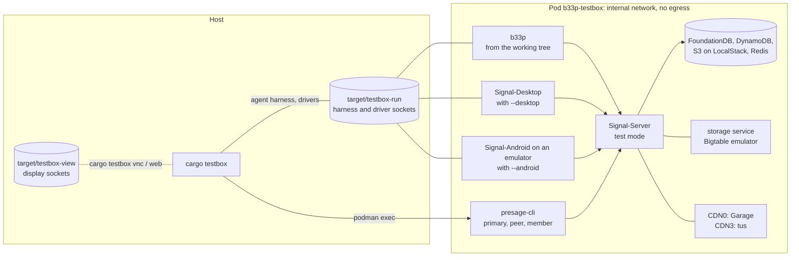
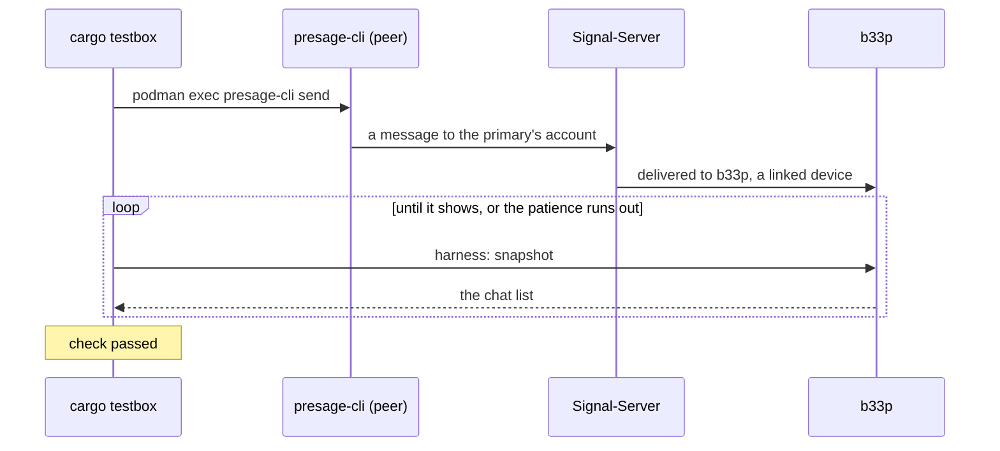
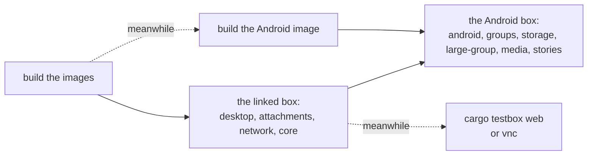

# testbox

Checks b33p against Signal's own server and clients, in one Podman pod on your machine:
Signal-Server in its test mode with the stores and CDNs it uses, the storage service, Signal-Desktop
and Signal-Android on an emulator. presage-cli plays the primary devices b33p links to. The pod's
network is internal: nothing in it reaches Signal or anything else outside. Every upstream is
pinned, and images take network only while they build.

A pass shows that b33p agrees with Signal-Server's test mode and Signal's clients at their pins,
not with Signal's servers. Out of reach are what runs in Signal's enclaves (contact discovery,
SVR), a production phone's history, and Signal's servers themselves.

`cargo testbox --help` is the reference for the commands; `cargo testbox` is a Cargo alias
(`.cargo/config.toml`) of the `xtask` package.

## What is in the box



The xtask drives each client the way a person would: b33p through its
[agent harness](../b33p-harness) (what the window shows, and actions through the same code paths
as clicks and keys), Desktop and Android through drivers of their own (`testbox/desktop/driver.ts`,
`testbox/tools/src/bin/android.rs`), presage-cli by running it in its container. A check then
waits for what should show on the other side:



## What the host needs

- Linux with Podman, rootless: your user needs a subuid and subgid range (`/etc/subuid`,
  `/etc/subgid`). Netavark makes the pod's internal bridge, so the kernel's `bridge` and `veth`
  modules must load. Right after a kernel update, reboot first: until then the running kernel's
  modules may be gone, and `up` fails with `netavark: create bridge: Netlink error: Operation not
  supported`.
- `/dev/kvm`, readable and writable, for Signal-Android's emulator.
- Network while the images build, and room for them: around 10 GB of images, and build caches on
  top. The first `up` builds Signal-Server, the storage service, Signal-Desktop, libsignal and
  Signal-Android from source and takes a long while; later ones reuse the cache, and only b33p
  is rebuilt when it changes.
- Rust, as for b33p itself. `cargo testbox vnc` opens a window; `cargo testbox web` serves the
  displays as a page on loopback instead.

## Running the phases

```sh
cargo testbox test                # the default phases (not stress-*, tour, interop, family-*)
cargo testbox test desktop core   # some
cargo test -p xtask -- --ignored  # the default phases, as a test: its output only if it fails
```

`test` builds the images and plays the box itself. The phases share two boxes, each from
nothing (b33p must start unlinked, the accounts new): the linked box, then the Android box.
Each box is set up once, then its phases run one after the other, in the order below. The
Android image builds while the linked box runs.



| Phase | Box | What it checks |
|---|---|---|
| `desktop` | linked | Signal-Desktop, linked to the peer, on the other end of b33p: receipts, edits, formatting, reactions, replies, deletes and emoji each way |
| `attachments` | linked | pictures, files and audio through CDN3 between b33p and Desktop; a profile picture and a sticker pack through CDN0 |
| `network` | linked | the clients' link to the servers impaired with `tc netem` (the pod's `netem` container): slow and lossy, narrow, dead for a while with nothing to say so, and flapping; what gets through, and how long it takes |
| `core` | linked | b33p linked to a presage-cli primary, with a presage-cli peer: text both ways, delivery receipts, reconnecting after the server drops, a send it leaves unanswered and its retry |
| `android` | Android | Signal-Android registers as the primary and b33p links to it; text and receipts between the two accounts, each one's linked device in step |
| `groups` | Android | a group b33p makes with the peer and a presage-cli member; what b33p changes shows on Desktop and Android, and what they change on b33p |
| `storage` | Android | chat settings through the storage service, between b33p, Android (the primary) and Desktop |
| `large-group` | Android | a group of the peer and twenty presage-cli members more, made by b33p: its text to everyone (one sender-key request), and everyone's answers at once |
| `media` | Android | pictures through all three clients: Desktop's to b33p and Android, b33p's to Desktop and Android, b33p's again after a restart and in its viewer, which b33p downloads once only, as they come (none of what it sent, nothing again when shown); with `--capture`, `compare.md`'s Attachments says what each client moved, check by check. A camera-sized photo through `TESTBOX_MEDIA_PHOTO` ([the 2026-11-19 run](../docs/testbox-media-traffic-2026-11-19.md)) |
| `stories` | Android | stories to My Story, whose audience the phone keeps in the storage service: b33p's reaches the peer's Desktop and a presage-cli member in one sender-key request (`multi_recipient?story=true`) and is filed under My Story on the phone; Android's shows on b33p under My Story, the peer's under the peer; once Android leaves the peer out, b33p's next reaches the member only. Sets My Story back to everyone at its end |

The linked box links b33p to a presage-cli primary and Desktop to a presage-cli peer; the
Android box links b33p to Android and Desktop to the peer. On both, the peer's first message
to b33p's account is accepted before the phases start.

Each check prints `check <what>: passed (<seconds>)` or `failed (<seconds>): <why>`, and each
part (a box's setup, a phase) ends checking that no client lost a message or crashed, and that
b33p logged no ERROR line but the known kinds (xtask/src/checks/errors.rs lists them, each with
its reason); `test` fails if any check did. Each image's build output is in `target/testbox-build/<image>.log`. The setups are
in `xtask/src/checks/setup.rs`, the phases' checks one file per phase beside it.

`cargo testbox run` runs `test` in rounds and sums up at the end: `cargo testbox run --rounds 2`
runs every phase twice, `cargo testbox run desktop groups` only those.

`--fresh` (on `test` and `run`) runs each phase on a box of its own instead, as the stress
phases always are: slower, a box's setup for each, but no phase sees what another left, and
their order doesn't matter.

b33p is a debug build in the box, as in the checks' own builds. `--optimized` (on `up`, `test` and `run`)
builds it optimized as it ships instead, which takes longer: for what only shows in an
optimized build, or is too slow to tell apart in a debug one. It keeps debug assertions on
(Cargo.toml's `testbox` profile), since b33p refuses its test servers in a release build. `--b33p-memory <MiB>` limits each b33p's
container to that much memory, as a small machine would: past it the kernel kills b33p, and
"no client crashed" fails.

Boxes run beside each other as instances: `--instance <name>` (or `TESTBOX_INSTANCE`) on any
command gives the box its own pod, internal network, volumes and images, all named
`b33p-testbox.<name>`, and its own directories, `target/testbox-<name>-*`. Without it, the box is
`b33p-testbox` with `target/testbox-*`, as before. A box is held while `up`, `test`, `run` or
`down` changes it, from whichever worktree (`$XDG_RUNTIME_DIR/<pod>.lock`): a second command on
the same box fails at once and names `--instance`. The dot keeps an instance clear of the
`b33p-testbox-` prefix: of other `b33p-testbox-*` images, and of an older xtask's wipe, which
removes the volumes by it. Each box takes a Signal-Server, its stores
and the clients, Android's emulator the most, so the host's load is what limits how many run
well at once. `down --wipe` removes only its own box's volumes, by name, and its network.

`--jobs N` (on `test` and `run`) plays the boxes of one run at once instead of one after the
other: the linked box with its phases, the Android box with its, each stress phase and the mesh
are units, and with `--fresh` each phase is. N boxes, `<instance>-j1` … `-jN`, each play a
`cargo testbox test` of one unit, and take the next when they are done; the images are built
once, here, and tagged for each box (`--prebuilt`, which is for this and hidden). At most two
Android emulators run at once. A unit's output comes when it ends, its record is in its box's
record directory, and a box that failed stays up as `test`'s does, as the failed unit left it (its worker takes no
more units; the other boxes take the rest); the others go. More jobs
shorten a round, down to its longest phase (`network`); `--fresh --jobs 4` runs every phase on a
box of its own.

`cargo testbox doctor` lists the boxes on the machine by instance, with their pods, networks,
volumes and image tags, and says which are strays (a box with no pod that keeps its network or
volumes, as after a run that was killed) or idle (a pod left up that nobody holds).
`cargo testbox --instance <name> clean` says what it would take of one box, `--yes` takes it:
pod, volumes, network, image tags, and this worktree's scratch directories for it (not its
record); `clean --strays` does the same for every box with no pod and nobody holding it.

`stress-volume`, `stress-interrupt`, `stress-content`, `stress-concurrency` and `stress-soak`
run only when named, each on a box of its own, after the others: bursts of messages; b33p killed while it receives,
sends and saves; awkward texts, broken and huge pictures, odd file names; several clients
sending at once; half an hour of mixed traffic (`TESTBOX_SOAK_MINUTES`, from a seed it prints,
which `TESTBOX_SEED` repeats) while b33p's memory and open files are watched
([docs/testbox-stress.md](../docs/testbox-stress.md)).

`signal-cli` runs only when named, on a box of its own: b33p linked to a presage-cli primary, with
a presage-cli peer and [signal-cli](https://github.com/AsamK/signal-cli), registered as an account
of its own. signal-cli is Java on Turasa's libsignal-service-java and libsignal-net, neither
presage nor libsignal-service-rs, so it checks b33p against a third implementation: text both ways
with b33p and with presage-cli, delivery receipts, a picture both ways (the bytes compared), ten
texts in a row, a group b33p makes of it and the peer, and signal-cli linked to the primary b33p is
linked to. Its image builds libsignal and signal-cli from source
([docs/onboarding-signal-cli.md](../docs/onboarding-signal-cli.md)), a long build the first time;
`up --signal-cli` plays a box with its container.

`signalmeow` runs only when named, on a box of its own: mautrix-signal's Go implementation of
Signal's client protocol (no presage, no libsignal-service; only libsignal's cryptography through
its FFI) linked to a presage-cli account, writing text, files and a group message with a
presage-cli peer and with b33p, and the other way round
([docs/onboarding-signalmeow.md](../docs/onboarding-signalmeow.md)). It is built at the first run,
which takes a while (libsignal's FFI, then Go); `up --signalmeow` plays a box with it.

`mixed` runs only when named, on a box of its own: b33p, a presage-cli account, signal-cli,
signalmeow and Flare's backend write to one another in overlapping bursts, and every client's own
record of what it received is held to every message once, in each sender's order
(`xtask/src/checks/mixed.rs` names its `TESTBOX_MIXED_*` knobs;
[docs/testbox-clients-run-2026-11-13.md](../docs/testbox-clients-run-2026-11-13.md) is its first
run).

`family-gurk` and `family-flare` run only when named, each on a box of its own: gurk-rs and Flare's
backend, clients on the presage and libsignal-service they ship with rather than b33p's fork's,
writing to b33p and a presage-cli peer (`testbox/family`,
[docs/onboarding-presage-family.md](../docs/onboarding-presage-family.md)); `up --family` plays a
box with both.

`--android-app molly` puts Molly, a hardened fork of Signal-Android on an older release, on the
emulator in Signal-Android's place, and the phases that drive Android drive it
([docs/onboarding-molly.md](../docs/onboarding-molly.md)).

`tour` runs only when named, on a box of several b33ps (`--b33ps <N>`, three by default), each
linked to a presage-cli primary of its own and writing to the others: every feature b33p has,
each `TESTBOX_TOUR_REPEAT` times (two), in an order drawn from a seed it prints, which
`TESTBOX_SEED` repeats; after each step every b33p it reaches has to show what a model of the
chats says (`xtask/src/checks/tour.rs`). How long each kind of step took, how long a message
took to show on the others, and each b33p's memory and open files are in the record's
`tour.json`. `--b33ps` gives the other boxes more b33ps too, and `up` a box of that many; the
first is `b33p` as ever, the others `b33p-1`, `b33p-2`, … in the logs, displays and records.

## Watching and looking into a failure

- `cargo testbox web` prints the address of a page with each client's display; `cargo testbox vnc`
  shows them in a window. Without `--interactive` they only show: your keys and clicks would race
  the drivers'.
- Every box leaves a record in `target/testbox-record/test/<when it started>/<box>/` (`<box>`
  beside it leads to the latest; `run`'s are in
  `target/testbox-record/run/<when it started>/<round>/<box>/`, and with `--jobs` each of its
  boxes' in `target/testbox-<instance>-j<k>-record/`): each container's log,
  Desktop's own logs and Android's logcat as they were at the box's end, so they outlast the
  next `down --wipe`, and the host's load then (`load.txt`). Signal-Server is stopped for its
  log and started again, so that its queued lines are in it (testbox/container-logs.md).
- `test --screenshots` (and `run --screenshots`) also takes each client's display after each
  check into the record, in a directory for each part (`setup`, then each phase), numbered in
  the order of the checks and named after them
  (`desktop/07-text-from-b33p-reaches-desktop-b33p.png`). b33p's harness draws its window from
  the state the check left (its display catches up only later, often a check late; popups,
  windows of their own, aren't in it); `testbox/shot` takes Desktop's and Android's over the
  displays' sockets.
- `test --capture` (and `run --capture`) also writes the wire down, for comparing Signal's own
  clients with b33p. A `capture` container runs tcpdump on the pod's loopback, where every
  connection in the box goes, into `target/testbox-capture/capture.pcap`; each server writes its
  TLS sessions' secrets beside it (`SSLKEYLOGFILE`, `keys-<server>.log`: Signal-Server and
  storage-service through the jSSLKeyLog agent, as the JDK writes none itself, and
  Signal-Server's omnibus port on the JDK's TLS engine (`grpc.sslProvider: JDK`) instead of
  Netty's BoringSSL, which the agent can't see; the CDN fronts and the preview page through rustls; CDN3's TLS is a front of
  the box's own in front of `wrangler dev`, whose HTTPS writes none). Nothing stands between the
  clients and the servers.
  At the box's end the record gets both in `wire/raw/`, and xtask/src/wire decodes them: the TCP
  connections to the servers' ports, their TLS 1.3 opened with the key logs, then HTTP/1.1,
  HTTP/2, WebSocket and Signal's envelopes into `events.jsonl`, a transcript per client under
  each check's name, `connections.jsonl` (each connection's client, address, ALPN and TLS
  fingerprint), and `compare.md`, the clients side by side (with what each downloaded from and
  uploaded to the CDNs, check by check). `cargo testbox wire <record>` decodes
  a record again. Not for the stress phases.
- With it, `wire/capture.pcapng`: the capture and the key logs in one file, the secrets in its
  Decryption Secrets Block. Open it in Wireshark and the box's traffic is decrypted, nothing to
  configure (`tshark -r capture.pcapng -Y http2.headers` likewise); `connections.jsonl`'s `peer`
  names the TCP stream a connection is. The raw `capture.pcap` and `keys-*.log` stay in `wire/raw/`
  for `editcap --inject-secrets` or anything else that reads a key log. A connection the capture
  can't open (a handshake that never finished, a session without secrets) is in
  `connections.jsonl` with `failed` saying why.
- `cargo testbox logs b33p server` prints those containers' logs; the names are those in
  `pod.yaml` (`b33p`, `server`, `storage`, `presage`, `desktop`, `android`, …). The last box
  stays up after `test`, so a failure on it can be looked at as it was.
- `cargo testbox qr` puts the link QR b33p shows on the emulator camera's poster, for linking by
  hand in Android's scanner.
- `cargo testbox down` stops the pod and keeps the accounts and stores; `down --wipe` removes them
  too.
- `just stop-android` (`testbox/android/stop-android.sh`) takes down every box with an Android
  container, through `down` and so under each box's lock, and then stops the emulators and adb
  servers left on the host, such as an emulator started by hand. `--dry-run` only lists them.

## Layout

| Path | What it is |
|---|---|
| `pod.yaml` | The pod for `podman kube play`; `desktop/pod.yaml` and `android/pod.yaml` are the clients' containers, put in when asked for |
| `<service>/Containerfile` | Each image, built at pinned revisions |
| `server/`, `storage/`, `foundationdb/`, `dynamodb/`, `garage/`, `tus/` | Signal-Server, the storage service, and the stores and uploads they run on |
| `b33p/` | b33p's image and its container in the pod |
| `android/` | The emulator's image, the on-device agent (`agent/`), and `stop-android.sh` |
| `molly/` | Molly in Signal-Android's place (`--android-app molly`) |
| `family/` | gurk-rs and Flare's backend, with the patches that point them at the box (`family-*` phases) |
| `capture/` | The tcpdump container `--capture` adds to the pod |
| `view/` | `view.sh`: b33p alone in a private display (cage and wayvnc in a container), for looking at a build and for `docs/screenshots/shoot.py` |
| `patches/` | What libsignal and Signal-Android need to run against a local server, and what Signal-Server needs on DynamoDB Local |
| `tools/` | The containers' entrypoints (`provision` makes the box's keys and servers file), the Android driver, and the drivers' protocol |
| `desktop/driver.ts` | The Signal-Desktop driver, on Playwright |
| `vnc/`, `viewer/`, `web/`, `shot/` | The displays: the VNC client, the window, the page, the screenshots |
| `presage/`, `stickers/` | presage-cli at b33p's pin, and the tool that seeds a sticker pack |
| `signal-cli/` | signal-cli at a release, built with `patches/signal-cli-local.patch` on libsignal with `patches/libsignal-cli-local.patch` |
| `signalmeow/`, `patches/signalmeow-local.patch` | mautrix-signal's Go client, built from source with a driver on top, for the `signalmeow` phase |
| `nightly/` | A tour run on main in a worktree and box of its own, and the systemd units to run it nightly |
| `logexp/` | The log-driver measurements behind `container-logs.md` |
| `../xtask` | `cargo testbox` itself: bringing the pod up and down, and the phases' checks |
